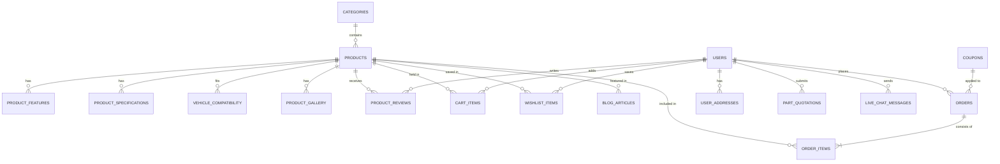

# AutoGenuine Database System Specification & Documentation

**Project Name**: AutoGenuine - Genuine Car Spare Parts Online E-Commerce System  
**Document Version**: 2.0 (Relational Model in 3NF)  
**Target DBMS**: MySQL 5.7+ / MySQL 8.0 / MariaDB / phpMyAdmin / PostgreSQL compatible  
**Database Name**: `autogenuine_db`  
**Primary Script**: [`database.sql`](file:///c:/Users/ASUS/Desktop/ProjectY/database.sql)

---

## 1. Executive Summary & Database Scope

The **AutoGenuine** database is designed to power an online automotive e-commerce platform with precision fitment checks, multi-currency pricing, customer authentication, order management, promo discounts, custom part quotation inquiries, product reviews, and blog publishing.

### Key Architectural Highlights
- **17 Normalized Relational Tables** adhering to **Third Normal Form (3NF)**.
- **Referential Integrity**: Cascading deletes (`ON DELETE CASCADE`) on child records and restrictive rules (`ON DELETE RESTRICT`) on critical financial and product records.
- **Search Optimization**: Multi-column indexes on SKU, OEM numbers, car makes/models, and categories.
- **Audit Trails**: Automatic timestamps on records (`created_at`, `updated_at`).

---

## 2. Entity-Relationship (ER) Diagram



---

## 3. Data Dictionary (Complete Table Catalog)

### 1. `categories`
Stores product categories displayed in the Shop section and category filter pills.
- `category_id` (`INT`, PK, Auto Increment) — Unique category ID.
- `name` (`VARCHAR(100)`, NOT NULL) — Category display name (e.g. *Brake Parts*, *Engine Parts*).
- `slug` (`VARCHAR(100)`, NOT NULL, UNIQUE) — URL-friendly slug (e.g. `brake-parts`).
- `description` (`TEXT`) — Overview description.
- `image_url` (`VARCHAR(255)`) — Representative category image.
- `is_active` (`BOOLEAN`, DEFAULT TRUE) — Soft-delete / active status.

### 2. `products`
The core catalog table holding all 9 genuine spare parts.
- `product_id` (`INT`, PK, Auto Increment) — Unique numeric ID.
- `slug_id` (`VARCHAR(100)`, UNIQUE) — URL query parameter slug (e.g. `brake-pad-set`).
- `sku` (`VARCHAR(50)`, UNIQUE) — Stock Keeping Unit (e.g. `AG-BRK-4091`).
- `oem_number` (`VARCHAR(100)`) — Manufacturer OEM part number (e.g. `04465-02220`).
- `name` (`VARCHAR(255)`, NOT NULL) — Product full title.
- `category_id` (`INT`, FK -> `categories.category_id`).
- `brand` (`VARCHAR(100)`) — OEM brand name (e.g. *Brembo*, *Toyota OEM*, *Denso*).
- `origin` (`VARCHAR(100)`) — Country of origin (e.g. *Japan*, *Italy*, *Germany*).
- `price` (`DECIMAL(10,2)`, NOT NULL) — Unit selling price (LKR).
- `original_price` (`DECIMAL(10,2)`) — Pre-discount price for sales tags.
- `discount_percent` (`INT`) — Discount percentage.
- `rating` (`DECIMAL(2,1)`) — Average customer star rating (1.0 - 5.0).
- `reviews_count` (`INT`) — Total count of customer reviews.
- `stock_quantity` (`INT`, DEFAULT 10) — Available inventory stock.
- `in_stock` (`BOOLEAN`, DEFAULT TRUE) — Availability flag.
- `main_image` (`VARCHAR(255)`) — Main product photograph path.
- `short_description` (`TEXT`) — Summary text for search & overview cards.
- `full_description` (`TEXT`) — In-depth product description.
- `warranty` (`VARCHAR(150)`) — Warranty coverage period.

### 3. `product_features`
Bullet points and key selling features for the product details view.
- `feature_id` (`INT`, PK, Auto Increment).
- `product_id` (`INT`, FK -> `products.product_id` ON DELETE CASCADE).
- `feature_text` (`VARCHAR(255)`).
- `display_order` (`INT`).

### 4. `product_specifications`
Key-value pair technical parameters (Thickness, Bolt PCD, Voltage, Ampere, Capacity).
- `spec_id` (`INT`, PK, Auto Increment).
- `product_id` (`INT`, FK -> `products.product_id` ON DELETE CASCADE).
- `spec_name` (`VARCHAR(100)`).
- `spec_value` (`VARCHAR(255)`).

### 5. `vehicle_compatibility`
Powers the **Vehicle Fitment Checker** tool on the website.
- `compatibility_id` (`INT`, PK, Auto Increment).
- `product_id` (`INT`, FK -> `products.product_id` ON DELETE CASCADE).
- `make` (`VARCHAR(100)`) — Vehicle make (e.g. *Toyota*, *Honda*, *Nissan*).
- `model` (`VARCHAR(150)`) — Vehicle model and chassis codes (e.g. *Premio NZT260*, *Vezel RU1*).
- `years_compatible` (`VARCHAR(50)`) — Model year range (e.g. *2007 - 2021*).
- `engine_code` (`VARCHAR(150)`) — Engine displacements and codes (e.g. *1NZ-FE*, *1KD-FTV*).

### 6. `users`
Customer accounts, credentials, and profile vehicles.
- `user_id` (`INT`, PK, Auto Increment).
- `full_name` (`VARCHAR(150)`, NOT NULL).
- `email` (`VARCHAR(150)`, NOT NULL, UNIQUE).
- `phone` (`VARCHAR(30)`).
- `password_hash` (`VARCHAR(255)`).
- `registered_vehicle` (`VARCHAR(150)`).
- `role` (`ENUM('customer', 'admin', 'mechanic')`).

### 7. `coupons`
Discount promo vouchers.
- `coupon_id` (`INT`, PK, Auto Increment).
- `code` (`VARCHAR(50)`, UNIQUE) — Coupon code (e.g. `WELCOME10`).
- `discount_percent` (`INT`) — Discount percentage (10%).
- `min_order_amount` (`DECIMAL(10,2)`).
- `valid_from` (`DATE`), `valid_to` (`DATE`).
- `is_active` (`BOOLEAN`).

### 8. `orders` & `order_items`
Stores customer orders placed on `cart.html` with financial calculations.
- **`orders`**: `order_id`, `order_reference` (e.g. `#AG-84920`), `user_id`, `customer_name`, `customer_phone`, `delivery_address`, `city`, `district`, `payment_method`, `payment_status`, `subtotal`, `discount_amount`, `shipping_fee`, `total_amount`, `order_status`, `order_date`.
- **`order_items`**: `order_item_id`, `order_id`, `product_id`, `product_name`, `unit_price`, `quantity`, `subtotal`.

### 9. `cart_items` & `wishlist_items`
User shopping cart and saved wishlist persistence tables.
- `cart_items`: `cart_item_id`, `user_id`, `product_id`, `quantity`, `updated_at`.
- `wishlist_items`: `wishlist_item_id`, `user_id`, `product_id`, `added_at`.

### 10. `product_reviews`
Customer ratings, feedback, and verified buyer badges.
- `review_id`, `product_id`, `user_id`, `author_name`, `avatar_initials`, `location`, `rating`, `title`, `comment`, `is_verified_purchase`, `created_at`.

### 11. `part_quotations`
Custom spare part sourcing requests submitted via `#contactQuotationModal`.
- `quotation_id`, `quotation_reference` (e.g. `#QUOT-7391`), `user_id`, `customer_name`, `phone`, `vehicle_make_model`, `manufacturing_year`, `chassis_vin`, `parts_details`, `status`, `created_at`.

### 12. `blog_articles`
Automotive maintenance articles and educational guides.
- `article_id`, `title`, `category`, `author`, `read_time`, `image_url`, `excerpt`, `content_html`, `related_product_id`, `created_at`.

### 13. `live_chat_messages`
Live chat support message streams and timestamps.
- `message_id`, `session_id`, `user_id`, `sender_type`, `message_text`, `sent_at`.

---

## 4. Normalization Compliance (3NF Proof)

1. **First Normal Form (1NF)**:
   - All columns contain atomic, indivisible values.
   - Repeating groups (features, specs, compatibility, order items) are broken into dedicated related tables with primary keys.
2. **Second Normal Form (2NF)**:
   - Meets 1NF.
   - All non-key attributes are fully functionally dependent on the entire primary key (no partial dependencies).
3. **Third Normal Form (3NF)**:
   - Meets 2NF.
   - No transitive functional dependencies (e.g., category details are separated into `categories`, order line items into `order_items`).

---

## 5. Useful SQL Queries for University Viva / Examination

### Q1: Vehicle Fitment Query (Find all parts that fit a Toyota Premio)
```sql
SELECT p.product_id, p.name, p.brand, p.price, p.stock_quantity, vc.model, vc.engine_code
FROM products p
JOIN vehicle_compatibility vc ON p.product_id = vc.product_id
WHERE vc.make = 'Toyota' AND vc.model LIKE '%Premio%';
```

### Q2: Order Summary by Customer
```sql
SELECT o.order_reference, o.customer_name, o.order_date, o.order_status,
       COUNT(oi.order_item_id) AS total_items, o.total_amount
FROM orders o
JOIN order_items oi ON o.order_id = oi.order_id
WHERE o.user_id = 1
GROUP BY o.order_id;
```

### Q3: Low Stock Alert Report
```sql
SELECT sku, oem_number, name, brand, stock_quantity, price
FROM products
WHERE stock_quantity < 10
ORDER BY stock_quantity ASC;
```

### Q4: Total Sales Revenue & Discounts Given
```sql
SELECT 
    COUNT(order_id) AS total_orders,
    SUM(subtotal) AS gross_sales,
    SUM(discount_amount) AS total_discounts,
    SUM(total_amount) AS net_revenue
FROM orders
WHERE order_status != 'Cancelled';
```

---

## 6. How to Import `database.sql`

### Method A: phpMyAdmin (XAMPP / WAMP)
1. Open your browser and go to `http://localhost/phpmyadmin/`.
2. Click on the **Import** tab at the top.
3. Click **Choose File** and select [`database.sql`](file:///c:/Users/ASUS/Desktop/ProjectY/database.sql).
4. Click **Import** (or **Go**).
5. All 17 tables and seed data will be created under `autogenuine_db`.

### Method B: MySQL Command Line / Terminal
```bash
mysql -u root -p < "c:\Users\ASUS\Desktop\ProjectY\database.sql"
```

### Method C: MySQL Workbench
1. Open MySQL Workbench and connect to your local server.
2. Go to **File -> Open SQL Script...** and select `database.sql`.
3. Click the **Execute (Lightning Icon)** button to run the entire script.
